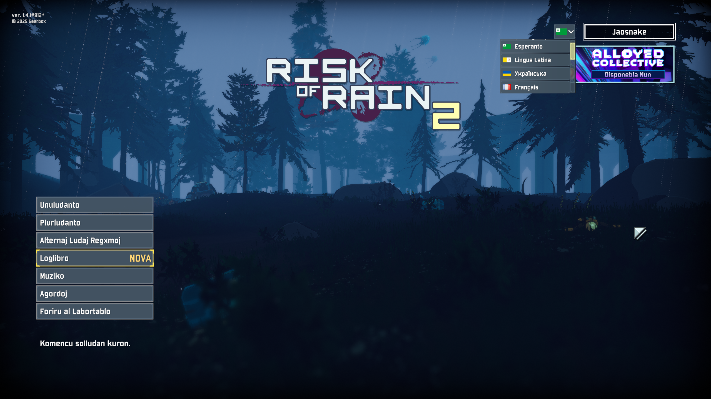
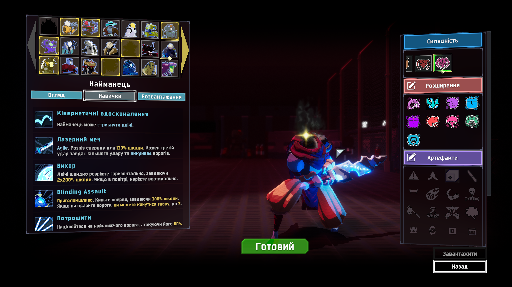

# P.E.L.E - Plugin for Enhanced Language Extension

P.E.L.E expands Risk of Rain 2 language support beyond the game's built-in
language list. It adds support for Ukrainian, Esperanto, Latin, Thai, Hindi, and Arabic while
remaining compatible with mods that already depend on `R2API.Language`.

It was created because custom community languages need more than translated
text files: they need menu entries, font support, reliable token loading, and a
way to keep many mod translations working as one coherent language pack.

## Thai, Hindi and Arabic

P.E.L.E includes base-game translations, fonts and language selection for these three languages. For mod content, install the separate [Sandswept LanguagePack](https://thunderstore.io/c/riskofrain2/p/Jaosnake/Sandswept_LanguagePack/) and [Starstorm 2 LanguagePack](https://thunderstore.io/c/riskofrain2/p/Jaosnake/Starstorm2_LanguagePack/) as needed. **A short delay is normal:** Thai, Hindi and Arabic need extra text preparation because the game does not natively support these writing systems. When you change languages or open a new screen, you may briefly see question marks before the translated text appears. Some content may remain in English, and a few interface elements may still show question marks.

## What P.E.L.E Adds

- Native custom language support for Ukrainian (`uk`), Esperanto (`eo`), and
  Latin (`la`), Thai (`th`), Hindi (`hi`), and Modern Standard Arabic (`ar`).
- P.E.L.E JSON translation packs for the base game and supported mods.
- Priority loading for P.E.L.E translations when another pack has the same
  token.
- Main-menu and pause-menu language selection.
- Keyboard, mouse, and controller hints in the language menu.
- F5 hot reload for P.E.L.E JSON files and normal `.language` files.
- Built-in Ukrainian/Cyrillic font support.
- Startup checks for missing folders, missing font data, and duplicate language
  DLLs.

## Optional KingModUtilities integration

P.E.L.E includes a separate `PELE.KingDBZFix.dll` compatibility plugin for the
[Goku](https://thunderstore.io/c/riskofrain2/p/Jaosnake/Goku_LanguagePack/), [Vegeta](https://thunderstore.io/c/riskofrain2/p/Jaosnake/Vegeta_LanguagePack/) and [Trunks](https://thunderstore.io/c/riskofrain2/p/Jaosnake/Trunks_LanguagePack/) translation packs. It localizes their KingModUtilities
transformation menus and tutorials, including Kaioken and Light Charge, in the
15 supported languages. The plugin activates when KingModUtilities is installed;
the P.E.L.E language system works without these characters or the utility.

The character translation packs require P.E.L.E 1.0.3. Install P.E.L.E first,
then the relevant character mod and its translation pack. P.E.L.E itself does
not install the character mods or KingModUtilities; the original character mods
provide their own dependencies. Text and compatibility may vary with mod updates.

## Translation status

The included translations are a work in progress. Coverage and linguistic
review vary between languages, game content, and mods; untranslated strings may
fall back to the original text. This release includes full DLC4 (*Seekers of the Storm*) translations for Ukrainian, Esperanto, and Latin (903 tokens per language).

## Screenshots

Main menu language selector:



Pause-menu language dialog:


Character select in Esperanto:


Character select in Ukrainian:



## Why These Languages?

Ukrainian is the main practical target because it needs clean custom-language
registration and Cyrillic font support. Esperanto and Latin are the first
experimental custom languages shipped with P.E.L.E, useful for testing the
loader, menus, and mod translation support outside the official language list.

This package includes every P.E.L.E translation file currently shipped in the
repository, even for mods you do not have installed. Risk of Rain 2 only uses a
token when matching game or mod content asks for it.

## Important

P.E.L.E replaces the `R2API.Language.dll` provided by
`RiskofThunder-R2API_Language`. It keeps the same BepInEx plugin GUID so mods
that depend on `R2API.Language` continue to work normally.

Some mods also install the upstream `RiskofThunder-R2API_Language` as a
dependency. P.E.L.E includes `PELE.LanguageGuard.dll`, a BepInEx preloader that
prevents a known duplicate from installing conflicting language hooks. When the
included P.E.L.E fork and the recognized upstream DLL are both present, it
backs up the upstream DLL to `BepInEx/PELE-LanguageGuard-backup`, records its
original relative path in `restore-paths.txt`, and removes that duplicate from
the active plugins folder. Other versions are left untouched.

The backup is not restored automatically if P.E.L.E is removed. To restore it,
reinstall `RiskofThunder-R2API_Language` with your mod manager, or copy the
backed-up DLL to the path recorded in `restore-paths.txt`. Do not manually add
extra copies of the fork. Compatibility with other versions and mods is not
guaranteed.

## Dependencies

Thunderstore installs these automatically:

```text
bbepis-BepInExPack-5.4.2121
RiskofThunder-HookGenPatcher-1.2.9
RiskofThunder-R2API_Core-5.3.0
```

`RiskofThunder-R2API_Language` is not listed as a dependency because P.E.L.E
provides the replacement `R2API.Language.dll` itself.

## Translation Priority

When P.E.L.E provides a token, it wins over other language packs. If P.E.L.E
does not provide that token, the normal game/mod language fallback is used.
Standalone language packs are available separately. Some older bundled translations remain in P.E.L.E; see each pack for language support.

## Included Three-Language Mod Support

The mods below have P.E.L.E translation packs for all three custom languages in
this release: Ukrainian, Esperanto, and Latin.

"Complete P.E.L.E support" here means this package includes matching P.E.L.E JSON
files for `uk`, `eo`, and `la` for that mod. It does not mean the original mod
author officially ships those languages.

This list was checked against the P.E.L.E language files included in this
release, not against the mods currently installed in a local profile.

The mods below include P.E.L.E JSON support for the listed languages, except Starstorm 2, which includes Esperanto and Latin only. For its Ukrainian, Thai, Hindi and Arabic translations, install its separate LanguagePack:

```text
Ukrainian (uk) | Esperanto (eo) | Latin (la)
```

| Mod | Thunderstore package |
| --- | --- |
| Alloyed Armorer | [TatertotticusSquad / Alloyed_Armorer](https://thunderstore.io/c/riskofrain2/p/TatertotticusSquad/Alloyed_Armorer/) |
| Arsonist | [PopcornFactory / Arsonist_Mod](https://thunderstore.io/c/riskofrain2/p/PopcornFactory/Arsonist_Mod/) |
| Assassin | [HasteReapr / AssassinMod](https://thunderstore.io/c/riskofrain2/p/HasteReapr/AssassinMod/) |
| Banshee | [tsuyoikenko / Banshee](https://thunderstore.io/c/riskofrain2/p/tsuyoikenko/Banshee/) |
| Bastian | [TeamSillyGuy / Bastian](https://thunderstore.io/c/riskofrain2/p/TeamSillyGuy/Bastian/) |
| Belmont | [rob / Belmont](https://thunderstore.io/c/riskofrain2/p/rob/Belmont/) |
| Chaos Angeloid | [DragonycksModdingComms / Chaos](https://thunderstore.io/c/riskofrain2/p/DragonycksModdingComms/Chaos/) |
| Cloudburst | [TeamCloudburst / Cloudburst](https://thunderstore.io/c/riskofrain2/p/TeamCloudburst/Cloudburst/) |
| Dancer | [nayDPz / Dancer](https://thunderstore.io/c/riskofrain2/p/nayDPz/Dancer/) |
| Dante | [rob / Dante](https://thunderstore.io/c/riskofrain2/p/rob/Dante/) |
| Deputy | [Bog / Deputy](https://thunderstore.io/c/riskofrain2/p/Bog/Deputy/) |
| Driver | [public_ParticleSystem / Driver](https://thunderstore.io/c/riskofrain2/p/public_ParticleSystem/Driver/) |
| Enforcer | [EnforcerGang / Enforcer](https://thunderstore.io/c/riskofrain2/p/EnforcerGang/Enforcer/) |
| Goku | [kinggrinyov / Goku](https://thunderstore.io/c/riskofrain2/p/kinggrinyov/Goku/) |
| HAND OVERCLOCKED | [EnforcerGang / HAND_OVERCLOCKED](https://thunderstore.io/c/riskofrain2/p/EnforcerGang/HAND_OVERCLOCKED/) |
| HEL P | [rob / HEL_P](https://thunderstore.io/c/riskofrain2/p/rob/HEL_P/) |
| Henry | [TheTimesweeper / HenryMod](https://thunderstore.io/c/riskofrain2/p/TheTimesweeper/HenryMod/) |
| Heretic | [Moffein / Heretic](https://thunderstore.io/c/riskofrain2/p/Moffein/Heretic/) |
| HUNK | [rob / HUNK](https://thunderstore.io/c/riskofrain2/p/rob/HUNK/) |
| Interrogator | [tsuyoikenko / Interrogator](https://thunderstore.io/c/riskofrain2/p/tsuyoikenko/Interrogator/) |
| Lee Hyperreal | [PopcornFactory / Lee_Hyperreal](https://thunderstore.io/c/riskofrain2/p/PopcornFactory/Lee_Hyperreal/) |
| Miner Unearthed | [EnforcerGang / MinerUnearthed](https://thunderstore.io/c/riskofrain2/p/EnforcerGang/MinerUnearthed/) |
| Mortician | [Bog / Mortician](https://thunderstore.io/c/riskofrain2/p/Bog/Mortician/) |
| Myst | [JavAngle / Myst](https://thunderstore.io/c/riskofrain2/p/JavAngle/Myst/) |
| Paladin | [Paladin_Alliance / PaladinMod](https://thunderstore.io/c/riskofrain2/p/Paladin_Alliance/PaladinMod/) |
| Pathfinder | [Bog / Pathfinder](https://thunderstore.io/c/riskofrain2/p/Bog/Pathfinder/) |
| Pilot | [EnforcerGang / Pilot](https://thunderstore.io/c/riskofrain2/p/EnforcerGang/Pilot/) |
| Ravager | [public_ParticleSystem / Ravager](https://thunderstore.io/c/riskofrain2/p/public_ParticleSystem/Ravager/) |
| Red Alert | [TheTimesweeper / Red_Alert](https://thunderstore.io/c/riskofrain2/p/TheTimesweeper/Red_Alert/) |
| Rifter | [toastyTeam / Rifter](https://thunderstore.io/c/riskofrain2/p/toastyTeam/Rifter/) |
| RiskyTweaks | [Risky_Lives / RiskyTweaks](https://thunderstore.io/c/riskofrain2/p/Risky_Lives/RiskyTweaks/) |
| Rocket | [EnforcerGang / Rocket](https://thunderstore.io/c/riskofrain2/p/EnforcerGang/Rocket/) |
| Seamstress | [tsuyoikenko / Seamstress](https://thunderstore.io/c/riskofrain2/p/tsuyoikenko/Seamstress/) |
| Sniper Classic | [EnforcerGang / SniperClassic](https://thunderstore.io/c/riskofrain2/p/EnforcerGang/SniperClassic/) |
| Sorceress | [Frosthex / SorceressMod](https://thunderstore.io/c/riskofrain2/p/Frosthex/SorceressMod/) |
| Spearman | [SaucySquash / Spearman](https://thunderstore.io/c/riskofrain2/p/SaucySquash/Spearman/) |
| Starstorm 2 (Esperanto and Latin) | [TeamMoonstorm / Starstorm2](https://thunderstore.io/c/riskofrain2/p/TeamMoonstorm/Starstorm2/) |
| Trunks | [kinggrinyov / Trunks](https://thunderstore.io/c/riskofrain2/p/kinggrinyov/Trunks/) |
| Vegeta | [kinggrinyov / Vegeta](https://thunderstore.io/c/riskofrain2/p/kinggrinyov/Vegeta/) |
| Wanderer | [tsuyoikenko / Wanderer](https://thunderstore.io/c/riskofrain2/p/tsuyoikenko/Wanderer/) |


## Additional compatible translation packs

The following separate translation packs include Ukrainian, Esperanto and Latin and can be used with P.E.L.E. Install the relevant translation pack separately; these mods are not part of the bundled P.E.L.E JSON list above.

| Mod | Translation pack |
| --- | --- |
| Aetherium | [Aetherium LanguagePack](https://thunderstore.io/c/riskofrain2/p/Jaosnake/Aetherium_LanguagePack/) |
| Caeli Imperium | [Caeli Imperium LanguagePack](https://thunderstore.io/c/riskofrain2/p/Jaosnake/Caeli_Imperium_LanguagePack/) |
| Celestial War Tank | [Celestial War Tank LanguagePack](https://thunderstore.io/c/riskofrain2/p/Jaosnake/Celestial_War_Tank_LanguagePack/) |
| Drow Ranger | [Drow Ranger LanguagePack](https://thunderstore.io/c/riskofrain2/p/Jaosnake/DrowRanger_LanguagePack/) |
| Ganondorf | [Ganondorf LanguagePack](https://thunderstore.io/c/riskofrain2/p/Jaosnake/Ganondorf_LanguagePack/) |
| HedgehogUtils | [HedgehogUtils LanguagePack](https://thunderstore.io/c/riskofrain2/p/Jaosnake/HedgehogUtils_LanguagePack/) |
| RealerMysticsItems | [RealerMysticsItems LanguagePack](https://thunderstore.io/c/riskofrain2/p/Jaosnake/RealerMysticsItems_LanguagePack/) |
| Sandswept | [Sandswept LanguagePack](https://thunderstore.io/c/riskofrain2/p/Jaosnake/Sandswept_LanguagePack/) |
| Sonic the Hedgehog | [Sonic the Hedgehog LanguagePack](https://thunderstore.io/c/riskofrain2/p/Jaosnake/SonicTheHedgehog_LanguagePack/) |
| Swan Song Extended | [Swan Song Extended LanguagePack](https://thunderstore.io/c/riskofrain2/p/Jaosnake/SwanSongExtended_LanguagePack/) |
| The House | [The House LanguagePack](https://thunderstore.io/c/riskofrain2/p/Jaosnake/TheHouse_LanguagePack/) |
| Ultron Survivor | [Ultron Survivor LanguagePack](https://thunderstore.io/c/riskofrain2/p/Jaosnake/UltronSurvivor_LanguagePack/) |

## More Jaosnake Translations

P.E.L.E is designed to work alongside my existing Risk of Rain 2 translation
packs. Those packs remain fully supported and are still recommended for the
other languages they already cover.

[Jaosnake packages on Thunderstore](https://thunderstore.io/c/riskofrain2/p/Jaosnake/)

## Source code

The [Thai, Hindi and Arabic language support and ShapeText renderer source](https://github.com/Jaosnake/ror2-multi-language-pack/tree/main/PELE/Source/LanguageSupport) includes build instructions and an explanation of the local text-rendering helper.

## Documentation

More technical details are available here:

- [Installation and compatibility](https://github.com/Jaosnake/ror2-multi-language-pack/blob/main/R2API.Language-Source/docs/WIKI.md#important-this-replaces-r2apilanguage)
- [Manual installation](https://github.com/Jaosnake/ror2-multi-language-pack/blob/main/R2API.Language-Source/docs/WIKI.md#manual-installation)
- [Configuration](https://github.com/Jaosnake/ror2-multi-language-pack/blob/main/R2API.Language-Source/docs/WIKI.md#configuration)
- [Translation file layout](https://github.com/Jaosnake/ror2-multi-language-pack/blob/main/R2API.Language-Source/docs/WIKI.md#translation-file-layout)
- [Technical hook notes](https://github.com/Jaosnake/ror2-multi-language-pack/blob/main/R2API.Language-Source/docs/HOOKS.md)
- [Manual test checklist](https://github.com/Jaosnake/ror2-multi-language-pack/blob/main/R2API.Language-Source/docs/MANUAL_TESTS.md)

## Questions and Support

For questions, suggestions, bug reports, or translation feedback, please open an
issue on GitHub:

[Jaosnake/ror2-multi-language-pack](https://github.com/Jaosnake/ror2-multi-language-pack)

---

## Support

[](https://ko-fi.com/jaosnake)

