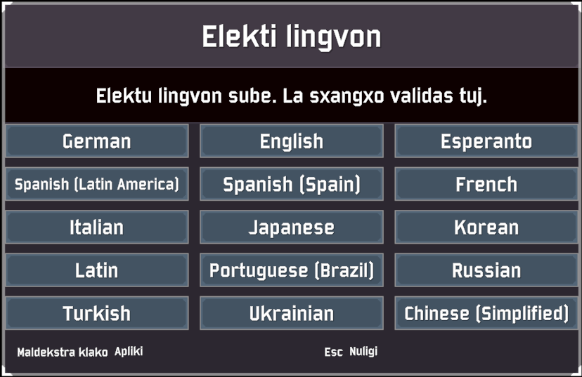
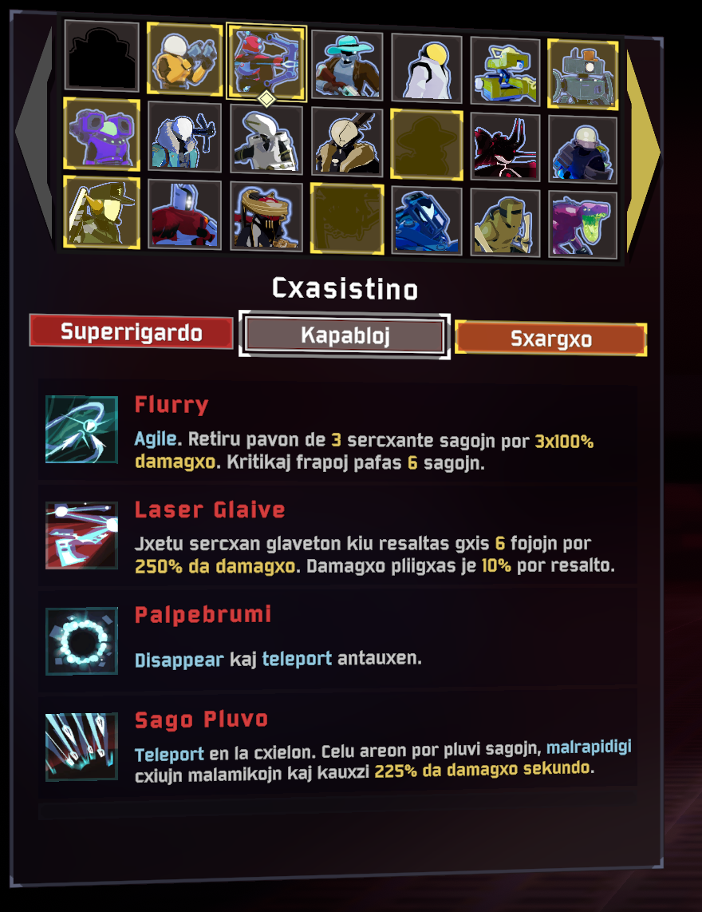

# P.E.L.E - Plugin for Enhanced Language Extension

P.E.L.E expands Risk of Rain 2 language support beyond the game's built-in
language list. It supports Ukrainian, Esperanto, Latin, Thai, Hindi, and Arabic,
with preview support for Greek and Vietnamese. It depends on the official
`RiskofThunder-R2API_Language` package and leaves its DLL intact on disk.

It was created because custom community languages need more than translated
text files: they need menu entries, font support, reliable token loading, and a
way to keep many mod translations working as one coherent language pack.

## New in 1.0.10

- Greek (`el`) and Vietnamese (`vi`) are available in the language selectors, with flags, font support, and sample base-game translations. Untranslated text can fall back to English.
- The pause-menu selector now keeps its Apply and Cancel hints inside the footer.
- F5 keeps the last valid copy of a P.E.L.E. JSON translation in the current session if a file cannot be reloaded. Other valid files can still reload.
- ShapeText can restart once if it stops responding. If it remains unavailable, the game reuses cached text where possible and uses a fallback font. Complex scripts may display with reduced shaping in this mode.
- The `langsource TOKEN` console command shows the resolved text and candidate translation sources. The build checks sample translations for placeholder, markup, and duplicate-key errors before packaging.

## Thai, Hindi and Arabic

P.E.L.E includes base-game translations, fonts and language selection for these three languages. For mod content, install the separate [Sandswept LanguagePack](https://thunderstore.io/c/riskofrain2/p/Jaosnake/Sandswept_LanguagePack/) and [Starstorm 2 LanguagePack](https://thunderstore.io/c/riskofrain2/p/Jaosnake/Starstorm2_LanguagePack/) as needed. **A short delay is normal:** Thai, Hindi and Arabic need extra text preparation because the game does not natively support these writing systems. When you change languages or open a new screen, you may briefly see question marks before the translated text appears. Some content may remain in English, and a few interface elements may still show question marks.

## What P.E.L.E Adds

- Language support for Ukrainian (`uk`), Esperanto (`eo`), Latin (`la`), Thai (`th`), Hindi (`hi`), and Modern Standard Arabic (`ar`).
- P.E.L.E. JSON translations for the base game and DLCs.
- Priority loading for P.E.L.E translations when another pack has the same
  token.
- Main-menu and pause-menu language selection.
- Keyboard, mouse, and controller hints in the language menu.
- F5 reloads P.E.L.E. JSON translations. Restart the game after changing external `.language` files.
- Built-in Ukrainian/Cyrillic font support.
- Startup checks for missing folders, missing font data, and duplicate language
  DLLs.

## Optional KingModUtilities integration

P.E.L.E includes a separate `PELE.KingDBZFix.dll` compatibility plugin for the
[Goku](https://thunderstore.io/c/riskofrain2/p/Jaosnake/Goku_LanguagePack/), [Vegeta](https://thunderstore.io/c/riskofrain2/p/Jaosnake/Vegeta_LanguagePack/) and [Trunks](https://thunderstore.io/c/riskofrain2/p/Jaosnake/Trunks_LanguagePack/) translation packs. It localizes their KingModUtilities
transformation menus and tutorials, including Kaioken and Light Charge, in the
15 supported languages. The plugin activates when KingModUtilities is installed;
the P.E.L.E language system works without these characters or the utility.

The character translation packs require P.E.L.E 1.0.3. Install P.E.L.E first,
then the relevant character mod and its translation pack. P.E.L.E itself does
not install the character mods or KingModUtilities; the original character mods
provide their own dependencies. Text and compatibility may vary with mod updates.

## Translation status

The included translations are a work in progress. Coverage and linguistic
review vary between languages, game content, and mods; untranslated strings may
fall back to the original text. Greek and Vietnamese are previews with partial base-game coverage.

## Screenshots

Main menu language selector:

Pause-menu language dialog:

Character select in Esperanto:

Character select in Ukrainian:

## Why These Languages?

Ukrainian is the main practical target because it needs clean custom-language
registration and Cyrillic font support. Esperanto and Latin are the first
experimental custom languages shipped with P.E.L.E, useful for testing the
loader, menus, and mod translation support outside the official language list.

P.E.L.E includes translations for the base game and its DLCs. Install the corresponding LanguagePacks separately for mod translations.

## Compatibility and updates

P.E.L.E requires the original RiskofThunder R2API.Language. Its own components add language selection, fonts, and text rendering while working with the official library. The official R2API.Language DLL is not bundled, modified, moved, or deleted.

If you used P.E.L.E 1.0.8 and R2API Language is missing, reinstall
RiskofThunder-R2API_Language using your mod manager before starting the game.
The earlier version could have moved its DLL to a backup folder.

## Dependencies

Your mod manager installs BepInEx, HookGenPatcher, R2API Core and the official
R2API Language as dependencies.

## Translation Priority

P.E.L.E provides base-game translations. Mod LanguagePacks provide their own translations, and the normal game and mod fallback applies where a translation is missing.
For mod translations, install the relevant standalone LanguagePack. The game and its DLCs are included.

## Separate LanguagePacks

Install each mod's LanguagePack separately. Language availability varies by pack.

| Mod | Translation pack |
| --- | --- |
| Aetherium | [Aetherium LanguagePack](https://thunderstore.io/c/riskofrain2/p/Jaosnake/Aetherium_LanguagePack/) |
| Caeli Imperium | [Caeli Imperium LanguagePack](https://thunderstore.io/c/riskofrain2/p/Jaosnake/Caeli_Imperium_LanguagePack/) |
| Celestial War Tank | [Celestial War Tank LanguagePack](https://thunderstore.io/c/riskofrain2/p/Jaosnake/Celestial_War_Tank_LanguagePack/) |
| Drow Ranger | [Drow Ranger LanguagePack](https://thunderstore.io/c/riskofrain2/p/Jaosnake/DrowRanger_LanguagePack/) |
| Ganondorf | [Ganondorf LanguagePack](https://thunderstore.io/c/riskofrain2/p/Jaosnake/Ganondorf_LanguagePack/) |
| HedgehogUtils | [HedgehogUtils LanguagePack](https://thunderstore.io/c/riskofrain2/p/Jaosnake/HedgehogUtils_LanguagePack/) |
| RealerMysticsItems | [RealerMysticsItems LanguagePack](https://thunderstore.io/c/riskofrain2/p/Jaosnake/RealerMysticsItems_LanguagePack/) |
| Sandswept | [Sandswept LanguagePack](https://thunderstore.io/c/riskofrain2/p/Jaosnake/Sandswept_LanguagePack/) |
| Sonic the Hedgehog | [Sonic the Hedgehog LanguagePack](https://thunderstore.io/c/riskofrain2/p/Jaosnake/SonicTheHedgehog_LanguagePack/) |
| Swan Song Extended | [Swan Song Extended LanguagePack](https://thunderstore.io/c/riskofrain2/p/Jaosnake/SwanSongExtended_LanguagePack/) |
| The House | [The House LanguagePack](https://thunderstore.io/c/riskofrain2/p/Jaosnake/TheHouse_LanguagePack/) |
| Ultron Survivor | [Ultron Survivor LanguagePack](https://thunderstore.io/c/riskofrain2/p/Jaosnake/UltronSurvivor_LanguagePack/) |

## More Jaosnake Translations

P.E.L.E is designed to work alongside my existing Risk of Rain 2 translation
packs. Those packs remain fully supported and are still recommended for the
other languages they already cover.

[Jaosnake packages on Thunderstore](https://thunderstore.io/c/riskofrain2/p/Jaosnake/)

## GitHub backups

- [P.E.L.E. 1.0.10 Thunderstore upload ZIP](../mods/PELE/Jaosnake-PELE-1.0.10-THUNDERSTORE.zip)
- [P.E.L.E. 1.0.9 archived ZIP](../mods/PELE/Jaosnake-PELE-1.0.9-THUNDERSTORE.zip)
- [Source and build instructions](Source/README.md)
- [Technical manual (PT-BR)](../docs/PELE.md)

The public ZIP backups omit local build paths in DLL debug metadata. The translation data in this directory follows the 1.0.10 package. Older bundled mod translations remain available in the [previous repository snapshot](https://github.com/Jaosnake/ror2-multi-language-pack/tree/209e0f1/PELE/Language).

## Documentation

More technical details are available here:

- [Installation and compatibility](https://github.com/Jaosnake/ror2-multi-language-pack)
- [Manual installation](https://github.com/Jaosnake/ror2-multi-language-pack/blob/main/R2API.Language-Source/docs/WIKI.md#manual-installation)
- [Configuration](https://github.com/Jaosnake/ror2-multi-language-pack/blob/main/R2API.Language-Source/docs/WIKI.md#configuration)
- [Translation file layout](https://github.com/Jaosnake/ror2-multi-language-pack/blob/main/R2API.Language-Source/docs/WIKI.md#translation-file-layout)
- [Technical hook notes](https://github.com/Jaosnake/ror2-multi-language-pack/blob/main/R2API.Language-Source/docs/HOOKS.md)
- [Manual test checklist](https://github.com/Jaosnake/ror2-multi-language-pack/blob/main/R2API.Language-Source/docs/MANUAL_TESTS.md)

## Questions and Support

For questions, suggestions, bug reports, or translation feedback, please open an
issue on GitHub:

[Jaosnake/ror2-multi-language-pack](https://github.com/Jaosnake/ror2-multi-language-pack)

---

## Support

